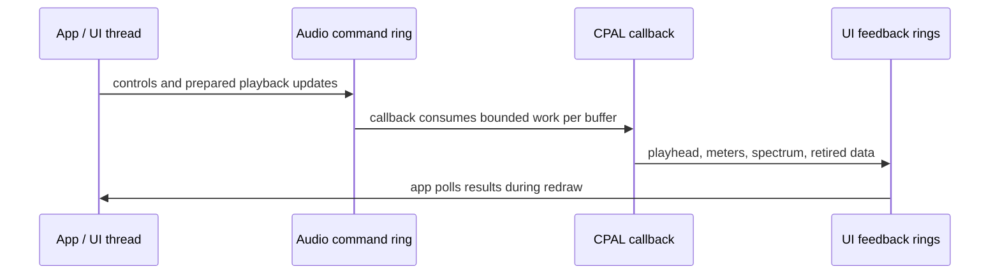

# glacier-app

`glacier-app` owns the desktop application, editable project state, graphics,
and the audio stream. The winit event loop handles UI input and drawing. CPAL
invokes the audio callback to render buffers. They communicate through
purpose-specific bounded SPSC ring buffers rather than calling into one
another directly.

The app is the authority for editable project data and save snapshots. Audio
holds playback-only state and reports runtime facts such as meters and
playhead position. Structural edits are prepared by the app and swapped into
audio at a buffer boundary; replaced heap data is returned to the app for
destruction.

Project loading and track import run on detached workers and return results to
the app over channels. Project saving uses one long-lived worker. These workers
handle file and preparation work away from the audio callback; they do not
replace the app's ownership of project state.

See [Audio Engine and Callback](./audio.md) for the command and runtime model,
[Project & Data Model](./score.md) for persisted and in-memory data, and
[IDs and Project Authority](./ids.md) for identity and edit ownership.
